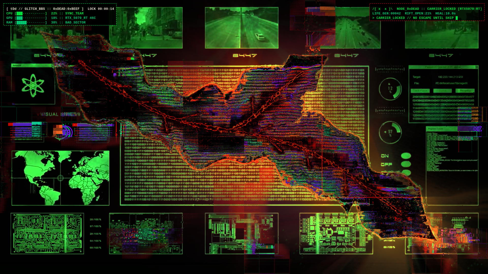
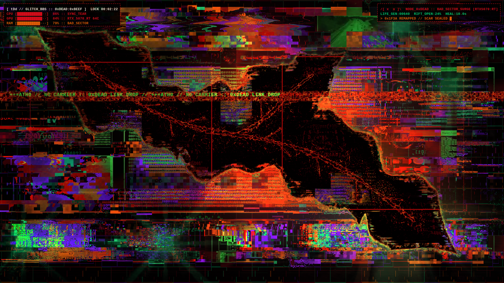
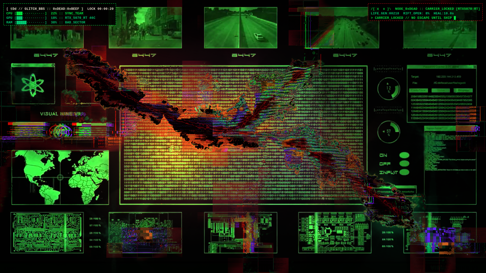
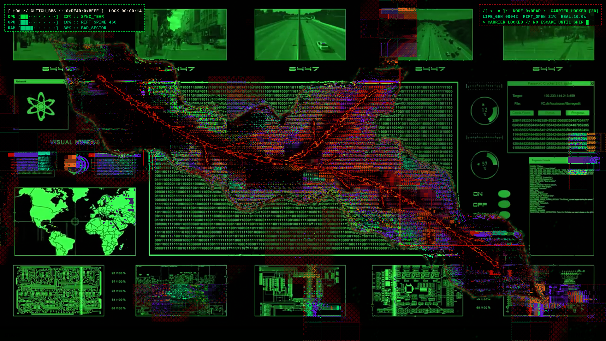

# VEIL-RIFT // Glitch-BBS & RTX 5070 Ray-Traced Linux X11 Wallpaper Engine

Interactive **OpenGL 3.3 + `libmpv` + Vulkan 1.3 Hardware RT-Core (`VK_KHR_ray_query`)** live desktop engine for X11 / i3wm, paired with a zero-overhead unified **Static + Gaming Mode** switcher and system tray applet.



---

## Core Architecture & Visual Layers

1. **3-Layer Shattered Veil-Rift Compositor (`corrupt-veil.frag`)**
   - **Layer 0 — Phosphor Hacker Matrix**: Dark-crushed emerald surveillance/circuit video (`libmpv` hardware-decoded into an offscreen FBO) keeping ~85–90% clean desktop calm at idle so translucent `0.70`-opacity terminals (`kitty`) and `0.90` blurred editors remain effortless to read.
   - **Layer 1 — Gen 1B Gloomy Multicolor Corruption**: High-contrast `#000000` black-crushed datamosh combining phosphor green, emerald, vivid royal ultraviolet, burnt sulfur-amber, byte-aligned crimson sync-tears, and living `[tDd//WATCHDOG]` & `[ICE//2400]` glitch ASCII constructs. Appears both inside **EWMH Window-Aware `32x18` Bad Sectors** (`_NET_CLIENT_LIST_STACKING`) that crowd open X11 window borders as CPU/GPU/RAM load climbs, and as the **wide transitional mid-shelf** inside mouse slashes.
   - **Layer 2 — Blackwall Blood Chasm & Cyber-Lightning Spine**: Strict zero-pink blackbody blood ramp (`#070002 -> #6e020a -> #c40814 -> #cc3b00`) with ridged-multifractal lightning filaments and a razor-thin molten spine. Over already-corrupted Bad Sectors, slashes invert contrast into a pitch-dark chasm so tears remain unmistakable at 100% system load.
2. **Ghostly GPU Conway's Game of Life (`corrupt-life-step.frag`)**
   - `640x360` ping-pong FBO cellular automaton seeded along the shattered fracture lips, Bad Sector perimeters, and X11 window frames.
   - Clings ghostly to rift edges, eating/fraying hard boundaries via 4x4 Bayer pixel selection and marching inward over a **10.0-second healing suture timeline**. Dwelling the cursor >1.5s nucleates a true Period-3 Conway Pulsar oscillator; dwelling >6.0s triggers a `[tDd//WATCHDOG]` fang micro-rift.
3. **Dual-Path Light Ray Tracing (`vk_rt5070.c` + `corrupt-rt5070.comp` + `corrupt-veil.frag`)**
   - **Hardware RT-Core Path (`[RTX5070:RT]`)**: Lazily activates discrete NVIDIA RTX hardware (`VK_KHR_acceleration_structure` + `VK_KHR_ray_query`, verified at **~1.5 ms/frame** on **NVIDIA GeForce RTX 5070** with strict `80 ms` non-blocking fence timeouts and single-submit batched command buffers). Extrudes slotted 3D panel bezels, live X11 window walls, and active Bad Sector monoliths into a dynamic BLAS/TLAS BVH to trace stratified area-light shadow rays, volumetric shafts, and 4-ray contact AO + local bounce GI (`480x270` `RGBA16F` with Jimenez IGN temporal accumulation).
   - **Hybrid RTD3 Guard & Native GLSL Ray Marcher (`[GL:RT]`)**: On hybrid AMD iGPU + headless NVIDIA dGPU systems where `NVreg_DynamicPowerManagement != 0` (laptop-style PCIe RTD3 D3cold), automatically keeps the headless NVIDIA GPU untouched (`0 MiB` VRAM, zero NVML/GSP RPC contention, preventing `NVRM: Xid 79` bus drops on mode transitions) and runs an 8-tap spine + 4-tap cursor GLSL shadow-ray marcher directly on the active display GPU. Plugging a display into the RTX GPU or setting `NVreg_DynamicPowerManagement=0x00` automatically unlocks `[RTX5070:RT]` (or force with `WALLPAPER_FORCE_VK_RT5070=1`).
4. **Unified Static + Gaming Mode (`wallpaper-mode static`)**
   - Combines static space wallpaper (`nasa-apod-wallpaper.sh` — NASA APOD + Bing UHD fallback) with Gaming Mode: stops all live GPU/video wallpaper processes and stops `picom` compositor in `< 0.6s` for zero compositor latency and 0% background GPU usage.

---

## Previews

| Mode / State | Preview |
| :--- | :--- |
| **RTX 5070 Hardware Light Ray Tracing (`corrupt-rt`)** — Slotted 3D bezel shadow shafts, 3D molten canyon bevels, vivid Gen 1B shelf & dark crimson spine |  |
| **Heavy CPU/GPU/RAM Load Surge** — Spreading Gen 1B Bad Sectors, contrast-inverted Blackwall chasm & `+++ATH0 // NO CARRIER` scan-band |  |
| **10.0s Suture Healing Timeline (t = 6.0s)** — Ghostly GPU Game of Life suturing jagged coves inward + cursor-dwell Period-3 Pulsar |  |
| **2D Veil-Rift Mode (`corrupt` + `raytrace-off`)** — Pure 2D pixel-selected Gen 1B + Blackwall tear without 3D light transport |  |

---

## Dependencies

Arch / CachyOS / Ubuntu equivalents:
- **System / C / GPU**: `gcc`, `make`, `glslang` (`glslangValidator`), `libx11`, `libepoxy`, `mpv` (`libmpv`), `vulkan-icd-loader`, `vulkan-headers`, `picom`, `feh`, `jq`, `imagemagick` (`identify`), `yt-dlp`, `ffmpeg`
- **Python 3**: `python-gobject` (GTK3 / GdkX11), `python-cairo`, `python-numpy`

---

## Build & Install

```bash
git clone https://github.com/Bit-Loop/VEIL-RIFT.git
cd VEIL-RIFT
./install.sh
```

> **Hybrid AMD iGPU + NVIDIA RTX Desktop Note**: If your monitor is plugged into the motherboard's AMD iGPU while an NVIDIA RTX 50-series GPU has 0 connected displays and `DynamicPowerManagement: 3` (RTD3 D3cold), `VEIL-RIFT` automatically runs OpenGL/VA-API + `[GL:RT]` on the display GPU so the headless NVIDIA card never crosses the 200 MiB RTD3 power-gate cliff (`NVRM: Xid 79`). To unlock hardware Vulkan `[RTX5070:RT]` without plugging a monitor into the RTX card, disable laptop RTD3 on your desktop via `/etc/modprobe.d/nvidia-pm.conf` (`options nvidia NVreg_DynamicPowerManagement=0x00`, rebuild initramfs, and reboot).

---

## CLI & System Tray Usage

```bash
# Activate Locked-In Corruption WITH hardware GPU Light Ray Tracing [RTX5070:RT]
wallpaper-mode corrupt-rt

# Activate Locked-In Corruption (preserves current raytrace on/off setting)
wallpaper-mode corrupt

# Toggle hardware Light Ray Tracing live on the fly (no wallpaper restart required!)
wallpaper-mode raytrace-toggle    # or: raytrace-on / raytrace-off / raytrace-status

# Unified Static + Gaming Mode (stops live wallpaper + stops picom + sets APOD/Bing static image)
wallpaper-mode static             # aliases: game, gaming, game-mode

# Standard YouTube / local MP4 video wallpaper mode
wallpaper-mode video
wallpaper-mode set-source-start "https://www.youtube.com/watch?v=..."

# Inspect full JSON telemetry & state
wallpaper-mode status-json

# Launch GTK system tray indicator
wallpaper-mode-tray.py &
```

### Recommended `i3` Keybindings (`~/.config/i3/config`)

```i3config
bindsym $mod+Shift+g exec --no-startup-id ~/.local/bin/wallpaper-mode toggle-gaming
bindsym $mod+Shift+c exec --no-startup-id ~/.local/bin/wallpaper-mode corrupt-rt
bindsym $mod+Shift+r exec --no-startup-id ~/.local/bin/wallpaper-mode raytrace-toggle
exec_always --no-startup-id ~/.local/bin/wallpaper-mode apply
exec --no-startup-id ~/.local/bin/wallpaper-mode-tray.py
```

---

## License

MIT
